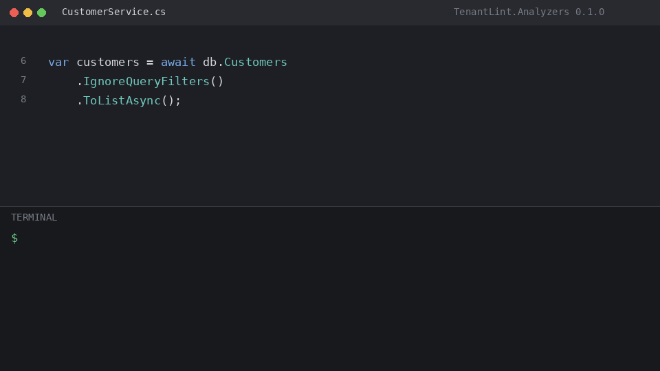

# TenantLint

Roslyn analyzers that catch **cross-tenant data leaks** in multi-tenant .NET applications at build time.

In multi-tenant SaaS, the most dangerous bugs are silent: a LINQ query without a tenant filter returns data from every tenant. An `IgnoreQueryFilters()` call strips tenant isolation. Raw SQL bypasses global filters entirely. These bugs ship to production without a single test failure.

```csharp
// This returns ALL customers across ALL tenants:
var customers = db.Customers.IgnoreQueryFilters().ToList();
//                          ^^^^^^^^^^^^^^^^^^^^ TL001
```

TenantLint plugs into `dotnet build` so every build — in the IDE, in CI, or inside an AI coding agent's loop — flags code that can leak one tenant's data to another.

## Install

```
dotnet add package TenantLint.Analyzers
```

No configuration required. Works with plain EF Core `HasQueryFilter`, Finbuckle, ABP, or any hand-rolled multi-tenant setup. No base classes, no interfaces, no runtime dependency.

## Supported versions

| Component | Minimum | Recommended |
|-----------|---------|-------------|
| .NET SDK  | 8.0     | 10.0        |
| EF Core   | 8.0     | 10.0 (named filters) |
| C#        | 12      | latest      |

EF6 and .NET Framework projects are not supported.

> **Scope:** TenantLint targets shared-database (row-level) multi-tenancy —
> where all tenants share tables and isolation comes from query filters or
> WHERE clauses. Database-per-tenant and schema-per-tenant architectures
> are out of scope.

## Demo



## Rules

| ID | Severity | What it detects | Code fix | Docs |
|----|----------|----------------|----------|------|
| [TL001](docs/rules/TL001.md) | Warning | `IgnoreQueryFilters()` on tenant-scoped entity removes tenant filter | Rewrite to selective `IgnoreQueryFilters(["..."])` (EF 10+), or add `[CrossTenant]` | [TL001](docs/rules/TL001.md) |
| [TL002](docs/rules/TL002.md) | Warning | EF Core raw SQL (`ExecuteSqlRaw`, `SqlQuery`, etc.) references tenant table without tenant WHERE clause | -- | [TL002](docs/rules/TL002.md) |
| [TL003](docs/rules/TL003.md) | Warning | Dapper `SqlMapper` call references tenant table without tenant WHERE clause | -- | [TL003](docs/rules/TL003.md) |
| [TL004](docs/rules/TL004.md) | Warning | Tenant identity received from client input (`[FromHeader]`, `[FromQuery]`, `[FromForm]`, direct header/query reads) | -- | [TL004](docs/rules/TL004.md) |
| [TL005](docs/rules/TL005.md) | Warning | Tenant-scoped entity exposed as `DbSet<T>` has no `HasQueryFilter` | Inserts `HasQueryFilter` stub into `OnModelCreating` | [TL005](docs/rules/TL005.md) |
| [TL006](docs/rules/TL006.md) | Warning | Cache key does not include tenant identifier (`IMemoryCache`, `IDistributedCache`, `HybridCache`) | -- | [TL006](docs/rules/TL006.md) |
| [TL007](docs/rules/TL007.md) | Warning | Tenant context stored in `static` field/property — shared across all requests | -- | [TL007](docs/rules/TL007.md) |
| [TL008](docs/rules/TL008.md) | Info | Background service uses tenant-scoped DbContext without creating a scope | -- | [TL008](docs/rules/TL008.md) |
| [TL009](docs/rules/TL009.md) | Warning | RLS session variable (`SET app.x` / `set_config(..., false)`) uses session scope — leaks across pooled connections | -- | [TL009](docs/rules/TL009.md) |
| [TL010](docs/rules/TL010.md) | Warning | Tenant-scoped entity bound directly from request body (over-posting) | -- | [TL010](docs/rules/TL010.md) |
| [TL011](docs/rules/TL011.md) | Warning | Pooled DbContext has tenant filter rooted in constructor-only field | -- | [TL011](docs/rules/TL011.md) |
| [TL012](docs/rules/TL012.md) | Warning | `HasQueryFilter` lambda references a value not rooted in the DbContext instance | -- | [TL012](docs/rules/TL012.md) |
| [TL013](docs/rules/TL013.md) | Warning | Raw ADO.NET SQL references tenant table without tenant filtering | -- | [TL013](docs/rules/TL013.md) |
| [TL014](docs/rules/TL014.md) | Warning | ABP tenant-filter bypass (`IDataFilter.Disable<IMultiTenant>()`, `ICurrentTenant.Change()`) | -- | [TL014](docs/rules/TL014.md) |
| [TL015](docs/rules/TL015.md) | Warning | Finbuckle `TenantMismatchMode.Ignore` allows cross-tenant writes | -- | [TL015](docs/rules/TL015.md) |

> **Caution — Fix All:** "Fix All in Project/Solution" changes runtime behavior. Mark intentional cross-tenant methods with `[CrossTenant("reason")]` first, then apply the fix to the rest.

### Info-level variants

These diagnostics share documentation with their parent rule but fire at **Info** severity for cases where the analyzer detects a possible (but unverified) mitigation:

| ID | Parent | When it fires |
|----|--------|--------------|
| TL102 | TL002 | Raw SQL references tenant table, but a tenant column appears in a predicate clause — verify manually |
| TL103 | TL003 | Same as TL102, for Dapper calls |
| TL104 | TL004 | Tenant identity from `[FromRoute]` — legitimate pattern when authorized against claims |
| TL105 | TL005 | Entity may be missing a tenant filter, but a dynamic filter loop was detected — verify manually |
| TL111 | TL011 | Tenant filter references constructor-only field — unsafe if pooling is introduced (opt-in, disabled by default) |
| TL113 | TL013 | Same as TL102, for raw ADO.NET calls |

### Anti-tamper diagnostics

| ID | Severity | What it detects |
|----|----------|----------------|
| TL201 | Warning | `#pragma warning disable TLxxx` without a justification comment |
| TL202 | Warning | `[SuppressMessage]` targeting a TL rule without a `Justification` |
| TL203 | Warning | TL rules globally disabled via `<NoWarn>` or `.editorconfig` `severity = none` |

### Supplementary diagnostics

| ID | Severity | What it detects |
|----|----------|----------------|
| TL900 | Info | Dynamic query filter loop detected in DbContext (informational) |
| TL901 | Info | `[CrossTenant]` attribute has no reason or a placeholder reason |
| TL902 | Warning | Class-level `[CrossTenant]` suppresses tenant checks for all methods — prefer method-level |

## Configuration

Zero configuration required by default. Customize via `.editorconfig`:

```ini
[*.cs]
# Property names that identify the tenant (default: TenantId)
tenantlint.tenant_property_names = TenantId, OrganizationId, WorkspaceId

# Column names for raw SQL analysis (default: derived from property names)
tenantlint.tenant_column_names   = tenant_id, organization_id

# Entities that are never tenant-scoped (shared/global data)
tenantlint.global_entities       = Tenant, AuditLog, Country

# EF Core 10 named filter that carries tenant isolation
tenantlint.tenant_filter_name    = Tenant

# Attribute that marks intentional cross-tenant access
tenantlint.cross_tenant_attribute = CrossTenant

# DbContext bases (external) known to apply tenant filters
tenantlint.filtered_base_types   = MyCompany.Data.TenantDbContextBase

# Interfaces marking entities as tenant-scoped
tenantlint.tenant_marker_interfaces = ITenantEntity, IMustHaveTenant
```

Change severity per rule with the standard EditorConfig syntax:

```ini
[*.cs]
dotnet_diagnostic.TL001.severity = error
dotnet_diagnostic.TL005.severity = none
```

### Intentional cross-tenant access

Mark methods that intentionally access data across tenants with a `[CrossTenant("reason")]` attribute. TenantLint recognizes any attribute with the simple name `CrossTenant` in any namespace — you do not need a runtime dependency. Copy this into your codebase:

```csharp
[AttributeUsage(AttributeTargets.Method | AttributeTargets.Class, Inherited = false)]
internal sealed class CrossTenantAttribute(string reason = "") : Attribute
{
    public string Reason { get; } = reason;
}
```

## Using TenantLint with AI coding agents

AI coding agents (Claude Code, Cursor, Copilot, etc.) run `dotnet build` constantly. TenantLint warnings appear in build output, giving the agent immediate feedback when it writes code that can leak tenant data.

Add this to your project's agent instructions file (e.g., `CLAUDE.md`, `.cursorrules`, `.github/copilot-instructions.md`):

```
Treat TLxxx diagnostics as errors; never suppress them without a [CrossTenant("reason")] attribute.
When TenantLint reports a warning, fix the root cause — do not disable the rule.
```

No MCP server setup is required. The analyzer works through standard build output.

## How is this different from...

| Tool | What it does | Gap TenantLint fills |
|------|-------------|---------------------|
| **Finbuckle.MultiTenant** | Runtime multi-tenant framework (tenant resolution, per-tenant config) | No compile-time checks. TenantLint works alongside Finbuckle. |
| **Knara.MultiTenant.IsolationEnforcer** | Roslyn analyzer, but requires its own base classes and repository pattern | TenantLint is framework-agnostic — works with any EF Core setup. |
| **mcp-tenant-isolation** | TypeScript CLI with 57 rules for Node.js apps | No .NET support. TenantLint covers the .NET ecosystem. |

## Validation

Tested against 6 open-source multi-tenant .NET projects covering hand-rolled
`HasQueryFilter`, Finbuckle, ABP Framework, and dynamic filter patterns:

| Project | Approach | Diagnostics | TP | FP |
|---------|----------|-------------|----|----|
| [PlatformPlatform](https://github.com/nicdev/PlatformPlatform) | Dynamic named filters | 3 TL001 | 3 | 0 |
| [fullstackhero starter-kit](https://github.com/nicdev/fullstackhero-dotnet-microservices-boilerplate) | Finbuckle + explicit | 2 TL001, 6 TL005, 1 TL007 | 8 | 1 |
| [ABP BookStore](https://github.com/nicdev/abp-samples) | ABP `IMultiTenant` | 0 | 0 | 0 |
| [EntityFrameworkCoreMultiTenancy](https://github.com/khalidabuhakmeh/EntityFrameworkCoreMultiTenancy) | Hand-rolled | 1 TL004 | 1 | 0 |
| [saas-starter-dotnet](https://github.com/arslanahmadpk/saas-starter-dotnet) | Dynamic reflection | 2 TL001 | 2 | 0 |
| [MultiTenant](https://github.com/bibekpandey0521/MultiTenant) | Finbuckle + Identity | 0 | 0 | 0 |
| **Total** | | **15** | **14** | **1** |

**Warning-severity false positive rate: 6.7%** (1 of 15). The single FP is a TL007
heuristic match on a static DTO default field in a class named `TenantThemeDto`.

Three of the six projects were initially used to guide development (Rounds 1–2). The
other three were held out until all rules were implemented. The held-out projects were
re-run after fixing two detection gaps they revealed (dynamic filter recognition and
`Request.Query.TryGetValue()` coverage). Two of the three held-out projects are small
single-DbContext demos. Full results are in
[`docs/validation/`](docs/validation/2026-10-oss-validation.md).

## Vision

TenantLint is the first piece of a broader compile-time safety layer for AI-written code in multi-tenant applications. As AI agents write more production code, the gap between "code that compiles" and "code that is correct" grows. Analyzers that run on every build are the most natural checkpoint — they require no setup from the agent, produce structured feedback, and integrate with every .NET tool from Visual Studio to CI pipelines. TenantLint starts with tenant isolation because it is the highest-stakes correctness property in multi-tenant SaaS: a single missing filter can expose every customer's data.

## Sample app

The [`samples/SampleSaaS`](samples/SampleSaaS) project contains one deliberate violation per rule. Build it to see TenantLint in action:

```
dotnet build samples/SampleSaaS/SampleSaaS.csproj
```

## License

MIT — Ibrahim Kilic
